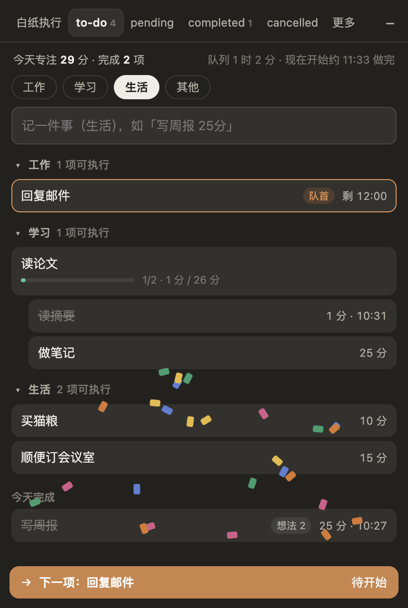
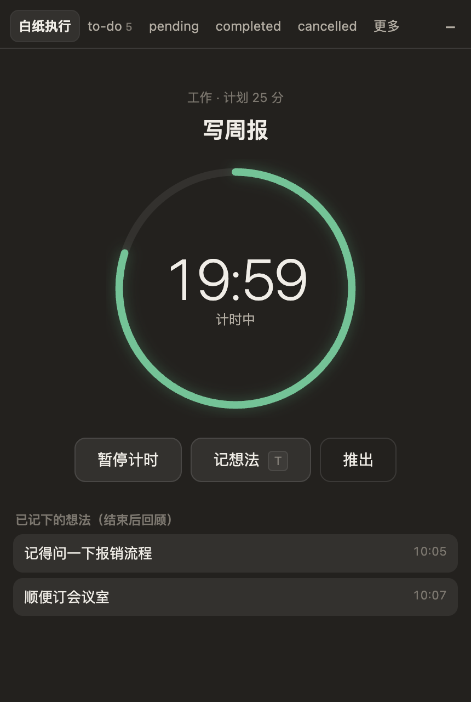

# Todo Cat

macOS 和 Windows 上的桌面悬浮待办：常驻悬浮球随手记任务，在「白纸执行」里一次计时做一件事，分心时先把想法记下来，到点后再集中回顾。附个人日历和一只可选的小猫。

技术栈：Electron + 本地 SQLite（Electron 自带的 `node:sqlite`，没有需要编译的原生依赖）。数据只存在本机，不需要账号，不需要服务器。

| | |
| --- | --- |
|  |  |

## 平台支持

| 平台 | 状态 |
| --- | --- |
| macOS（Apple Silicon / Intel） | 已在 macOS 15、Apple Silicon 上实际运行，并通过自动走查。Intel 包能构建，未在 Intel 机器上运行过。 |
| Windows 10 / 11（x64） | 代码已做平台适配，安装包能构建，**但还没有在真实 Windows 机器上运行验证**。已知差异见下文。 |

## 部署

### 1. 准备环境

- Node.js 22 或更新（开发时用的是 26）
- Git
- 约 500 MB 磁盘空间（Electron 运行时）

```bash
git clone https://github.com/Timing-up/todo-cat.git
cd todo-cat
npm install
```

`npm install` 会下载 Electron 运行时（约 100 MB）。下载慢时先设置镜像再安装：

```bash
export ELECTRON_MIRROR=https://npmmirror.com/mirrors/electron/
```

Windows PowerShell 下写作 `$env:ELECTRON_MIRROR="https://npmmirror.com/mirrors/electron/"`。

### 2. 直接运行（不打包）

```bash
npm start
```

屏幕右上方会出现一个橙色悬浮球，鼠标悬停或点击即可展开面板。

### 3. 打包成可分发的应用

**macOS**（需要在 Mac 上执行）：

```bash
npm run package:mac
```

产物：

- `dist/Todo Cat-darwin-arm64/Todo Cat.app`（Apple Silicon）
- `dist/Todo Cat-darwin-x64/Todo Cat.app`（Intel）

把对应的 `Todo Cat.app` 拖进「应用程序」文件夹即可。

**Windows**（在 Windows 或 Mac 上都能构建）：

```bash
npm run package:win
```

产物是文件夹 `dist/Todo Cat-win32-x64/`，把整个文件夹拷到目标机器，运行里面的 `Todo Cat.exe`。这是免安装的绿色版，没有安装程序。

### 4. 首次打开

应用没有付费的开发者证书签名，系统会拦一下：

- **macOS**：脚本只做了本地临时签名。从别的机器拷来的 App 首次打开会提示「无法验证开发者」，在 Finder 里右键 App →「打开」→ 再点「打开」。如果提示「已损坏」，执行：

  ```bash
  xattr -cr "/Applications/Todo Cat.app"
  ```

- **Windows**：SmartScreen 会提示「Windows 已保护你的电脑」，点「更多信息」→「仍要运行」。

### 5. 升级、数据与卸载

- **升级**：`git pull && npm install`，重新打包后覆盖旧的 App 或文件夹。数据库会自动迁移，数据不受影响。
- **数据位置**：
  - macOS：`~/Library/Application Support/Todo Cat/todocat.db`
  - Windows：`%APPDATA%\Todo Cat\todocat.db`
- **备份**：先退出应用，再拷走上面的 `todocat.db`（连同旁边的 `-wal`、`-shm` 文件）。
- **卸载**：删除 App（或文件夹），再删除上面的数据目录。
- **退出**：macOS 点菜单栏的 🐱，Windows 右键托盘图标，或在悬浮球上右键 →「退出 Todo Cat」。

### 6. 可选配置

| 环境变量 | 作用 |
| --- | --- |
| `TODOCAT_DATA_DIR` | 改用指定的数据目录（例如放一份测试数据） |
| `TODOCAT_TELEMETRY_URL` | 自愿上报的接收地址。**不设置时，即使用户打开了上报开关，事件也只留在本机队列里，不会发往任何地方。** |

## 怎么用

1. 在 to-do 里记下标题，末尾直接写时长再回车，例如「写周报 25分」「读论文 1h30」「散步半小时」；也可以回车后点 15/25/45/60 快捷项。
2. 点队首任务的「开始」进入白纸执行，一次只计时一件事。
3. 分心时点「记想法」（计时会暂停），写完回车，继续做事。
4. 到点后回顾想法：想过了就勾上，或一键转成新的待办。全部勾完才加载下一项。
5. 还没做完但想先放一放，点「推出」，任务进 pending，之后可以送回原位置按剩余时长继续。

### 快捷键

| 操作 | macOS | Windows |
| --- | --- | --- |
| 唤出面板并记一件事（全局） | ⌥⇧T | Alt+Shift+T |
| 执行中记想法（全局） | ⌥⇧I | Alt+Shift+I |
| 切换标签 | ⌘1–⌘6 | Ctrl+1–Ctrl+6 |
| 新待办 / 开始队首 / 暂停继续 / 记想法 / 收起 | N / Enter / 空格 / T / Esc | 同左 |

全局快捷键可以在「更多 → 设置」里关闭；被其他应用占用时设置页会提示未生效。

## 功能一览

- **悬浮球与面板**：可拖动、贴边、置顶；悬停展开，鼠标离开自动收起，编辑时保持展开；右键菜单。
- **任务**：四个分类（工作、学习、生活、其他）、两层任务、父任务按计划分钟汇总进度、同级拖动排序。
- **白纸执行**：环形倒计时、暂停、推出；计时到点自动提醒，记为「计时完成」。
- **想法**：录入时暂停计时；到点或推出后集中回顾；可转成待办；收件箱按天列出并可搜索。
- **日历**：日 / 周 / 月视图，统计实际运行时间、完成数和想法数；运行时间按本地午夜拆分。
- **小猫**：完成计时和每天首次打开得积分，可以喂猫；久未喂养会外出打猎，不影响待办使用。
- **保存与恢复**：退出、锁屏、睡眠时自动暂停并保存；异常退出后恢复到最后保存点并提示。
- **自愿上报**：默认关闭；只记录事件元数据，不含任务标题和想法正文；随时可撤回。

没有做的：账号与同步、到期日、手动勾完任务或提前结束计时、自动开始下一项。

## 已知限制

- **Windows 未实机验证**。与 macOS 的已知差异：面板是不透明底色（没有毛玻璃）；倒计时显示在托盘图标的悬停提示里，而不是任务栏文字。
- **开机自启动**在未正式签名的 macOS 包上会被系统拒绝，开关会提示失败。
- 积分数值、饥饿时长是占位值，尚未调优。
- 分类固定为四个，暂不能自定义。

## 开发

```bash
npm test       # 规则引擎与存储的单元测试
npm run e2e    # 在真实窗口里自动走查主流程（含强杀后恢复），截图输出到 e2e-shots/
```

走查使用临时数据目录，不会碰真实数据。

| 路径 | 内容 |
| --- | --- |
| `src/core/engine.js` | 规则引擎：任务、队列、计时、想法、回顾、推出、删除、恢复、积分。纯逻辑，时钟可注入 |
| `src/core/calendar.js` | 日 / 周 / 月统计 |
| `src/main/store.js` | SQLite 存储，每次保存一个事务；完成记录与积分用主键保证不重发 |
| `src/main/main.js` | 主进程：窗口、IPC、心跳保存、锁屏暂停、通知、快捷键、托盘、上报队列 |
| `src/renderer/` | 悬浮球、面板界面、一行录入解析、小猫插画 |
| `scripts/` | 图标生成、macOS 签名、走查启动器 |
| `test/` | 单元测试与端到端走查脚本 |

## 许可证

[MIT](LICENSE)
